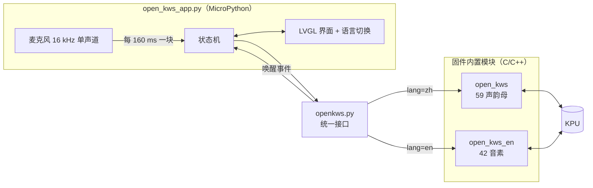

# 31-OPEN-KWS 开放词汇关键词唤醒（中文 / English）

想让设备听到「你好小楠」或者 "Hey Kendryte" 就响应？这个示例让你**用自己的声音，现场注册自己的唤醒词**，
中文和英文都可以。注册后设备持续监听麦克风，听到其中任何一个词就立即唤醒，并告诉你是哪一个。

注册和检测全部在 K230 开发板上离线完成：不需要电脑重新训练模型，也不需要联网。

> **中英文是两个独立的声学模型**：中文按 59 类声母/韵母建模，英文按 42 类 ARPAbet 音素建模，
> 归一化参数、阈值标定、注册文件都不通用。界面上的 **中文 / English** 按钮用来切换，
> 切换时会**释放旧模型再加载新模型**，任何时刻只有一个模型占用内存。
> 两种语言的唤醒词各存各的，互不影响，也不会互相误唤醒。

## 功能特点

| 特性 | 说明 |
|---|---|
| 唤醒词随你定 | 不限词表，录 3 遍就能注册。中文建议 4 个字以上（「你好小楠」）；英文建议 3 个音节、6 个音素以上（"Hey Kendryte"） |
| 中英文一键切换 | 顶部按钮同时切换**唤醒模型**和**界面语言**：中文时整个界面是中文的，英文时整个界面是英文的；固件里没装的语言会自动隐藏 |
| 多个唤醒词 | 每种语言最多 8 个，同时监听并区分是哪一个。所有词共用一次神经网络推理 |
| 分得清相似词 | 两道关卡判定：「你好小楠」vs「你好小智」、"Hey Ken" vs "Hey Kendryte" 都不会互相误唤醒；注册时还会提前拦下太像的词 |
| 响应快 | 每 160 ms 处理一次音频，说完到唤醒约 0.3 s；神经网络在 KPU 上运行 |
| 录音省心 | 说完即自动停止；声音太大时自动调低麦克风音量；没说话会超时提醒 |
| 唤醒提示 | 扬声器播放提示音，屏幕以该词的颜色高亮显示 |
| 灵敏度可调 | 三档，同时调整两道关卡的松紧；中英各有各的标定值 |
| 离线、私密 | 录音与注册结果只保存在开发板 SD 卡上 |

---

## 快速上手

在 VS Code 的 **CanMV 插件**中运行 `/sdcard/examples/31-OPEN-KWS/open_kws_app.py`，打开虚拟屏幕预览，用鼠标点击操作。

| 区域 | 内容 |
|---|---|
| 顶部 | 标题、**语言切换**（中文 / English）、灵敏度切换；下方一行显示操作提示和结果 |
| 得分卡片 | 曲线为所有唤醒词中「得分 − 阈值」的最大值，越过红线并通过第二道关卡即唤醒；下方有音量条、语音指示灯和处理耗时 |
| 唤醒词卡片 | 当前语言已注册的词：颜色、编号、阈值、解码出的单元（英文按音节用 `\|` 分隔），每行带删除按钮 |
| 底部按钮 | 注册新词 / New word、录音 / Record take N、开始检测 / Start detect、清空全部 / Clear all |

### 切换语言（同时切换界面语言）

点顶部的 **中文** 或 **English**，这一个按钮同时切换两件事：

| | 切换内容 |
|---|---|
| **唤醒功能** | 释放当前模型 → 加载另一种语言的模型、单元表、前端参数 → 载入该语言的唤醒词 |
| **界面显示** | 标题、按钮、状态提示、错误信息、灵敏度档位名称**全部**换成该语言 |

也就是说：选中文时整个界面是中文的，选英文时整个界面是英文的，不存在"中文界面配英文唤醒词"
这种混搭。中文界面需要 CJK 字体（`/sdcard/res/font/` 下的思源黑体）；英文界面全是 ASCII，
字体加载失败也能用 LVGL 内置字体正常显示。

切换会被记住，下次启动直接用上次的语言（存在 `settings.json`）。**注册过程中语言按钮会被禁用**，
请先完成或取消注册。

固件里只装了一种语言时（Kconfig 关掉另一个模块），按钮只显示那一种，界面也固定为该语言。

### ① 注册唤醒词

1. 点 **注册新词 / New word**。
2. 点 **录第1段 / Record take 1**，清楚地说一遍唤醒词。
   - 说完停顿约 0.8 秒自动结束（最长 4 秒）；7 秒内没说话会提示重录。
     开始录音后要**连续** 0.32 秒高于语音门限才算开口，一声关门、挪椅子不会触发；
     录到至少 0.64 秒人声之前不会结束，所以不会出现「还没说就录完了」。
   - 程序自动截取有声音的部分并检查录音质量。
3. 同样录完第 2、3 段，三遍保持相同的语速和音量。
4. 自动进入计算并显示进度；完成后新词立即可用，状态栏显示解码出的单元，例如
   `kw_0 enrolled: HH EY | K EH N | D R AY T   (threshold -2.330, 1 word(s) total)`。

注册过程中随时可以点 **取消注册 / Cancel**。

### ② 唤醒

点 **开始检测 / Start detect**，说出任意一个已注册的词。唤醒时曲线越过红线、屏幕弹出提示、
扬声器播放提示音，状态栏显示得分、阈值和最弱音节得分。

### ③ 灵敏度

漏唤醒多就调灵敏，误唤醒多就调保守。两种语言的档位是**分别标定**的：

| 档位 | 第一关偏移 | 核对序列条数 | α | δ | 说明 |
|---|---|---|---|---|---|
| 中文 灵敏 / 正常 / 保守 | −0.15 / 0 / +0.15 | 8 / 8 / 3 | 0 / 2.0 / 2.0 | 0 / 1.25 / 1.25 | 验证阈值 −3.0 |
| 英文 Sensitive / **Normal** / Conservative | −0.15 / 0 / +0.15 | 8 / 1 / 1 | 0 | 0 / 0 / **+1.4** | 验证阈值 **−6.0** |

> 英文只有 **Normal** 这一档有实测标定数据（K230 测试集：正例 64/64 检出，"Hey Ken-" 前缀 1/64 误触发）。
> Conservative 的 δ=+1.4 把验证阈值收紧到 −4.6，实测能消除该测试集上唯一的前缀误触发，
> 但离最差正例只剩 0.27 余量。拿不准就用 Normal。

### ④ 删除唤醒词

- 单个：该词右侧 **删除 / Delete** → **确认删除 / Confirm**（5 秒内）。列表滚动位置会保持，
  列满 8 个时删除靠下的词也不会跳回顶部。
- 全部：**清空全部 / Clear all** → 二次确认。**只清当前语言**，另一种语言的词不受影响。

### 注册时可能遇到的提示

| 提示 | 原因 | 处理 |
|---|---|---|
| 录音太短 / 太长 | 截取后不在 0.5–2.5 s（英文）或 0.6–2.5 s（中文）之间 | 完整说一遍唤醒词，不要多说别的 |
| 音量过低 | 峰值太小 | 靠近麦克风，30–100 cm 较合适 |
| 音量过大（削波） | 削顶采样过多且麦克风音量已到最低 | 离远一点或小声一些 |
| 没有检测到说话声 | 7 秒内音量一直没明显高于底噪 | 靠近麦克风、说大声些 |
| 几乎听不到人声 | 语音比底噪高不到 3 dB | 靠近麦克风、说话大声一些 |
| 唤醒词太短 | 中文音节少于 4；英文元音核少于 3 或音素少于 6 | 换更长的词（「小楠」→「你好小楠」、"Kendryte" → "Hey Kendryte"） |
| 几段录音差异太大 | 算出的阈值高于最差的那段 | 三遍保持一致 |
| 与已注册的 kw_x 太相似 | 新词会唤醒 kw_x | 换一个读音区别更明显的词 |
| 说 kw_x 时也会唤醒新词 | 新词是旧词的一部分 | 换一个词 |

录音的信噪比门限是 **3 dB**（`openkws.MIN_SNR_DB`），这是一道底线而不是质量标准 ——
低于它语音基本埋在噪声里，录下来也解码不出东西。信噪比在 3～10 dB 之间的录音会被
**收下并提示「环境偏吵」**，能不能接受由你判断；10 dB 以上（`WARN_SNR_DB`）不再提示。
底噪大的房间因此也能完成注册，代价是唤醒率可能偏低。

---

## 中英文的差异

共用的部分（**完全相同**）：log-Mel 前端的窗函数与梅尔滤波器、96 帧滑窗推理、CTC-forward 打分、
确认帧数、冷却时间、VAD、注册的阈值标定方法。

不同的部分：

| 项 | 中文 | 英文 |
|---|---|---|
| 建模单元 | 59 类（21 声母 + 35 韵母 + 3 特殊） | 42 类（39 ARPAbet 音素 + 3 特殊） |
| 归一化参数 | `zh/assets/cmvn_*.npy` | `en/assets/cmvn_*_en.npy` |
| 模型 | `zh/model/kws.kmodel`（0.95 MB） | `en/model/kws_en.kmodel`（1.64 MB） |
| 音节怎么分 | 由单元 id 直接推出（到韵母为止） | 注册时按「元音核 + 最大首音原则」切好写进注册文件，检测端不含语言规则 |
| 验证阈值 | −3.0 | **−6.0**（英文弱读使末音节天然偏低，照搬 −3.0 会误拒约 5% 的真实唤醒） |
| 长度门禁 | 音节 ≥ 4 | 元音核 ≥ 3 且音素 ≥ 6 |
| 注册文件目录 | `enroll/zh/` | `enroll/en/` |

---

## 实现原理

### 整体结构



**声学模型的作用**：模型不直接识别某个词，而是把声音转换成「单元」的概率序列。
任意一个词都可以写成一串单元 —— 中文「你好小楠」= `n i h ao x iao n an`，
英文 "Hey Kendryte" = `HH EY K EH N D R AY T` —— 所以不用重新训练模型就能支持任意的词。

### 流式检测

每块 160 ms 的音频：能量 VAD 判断有没有人说话 → log-Mel 特征（10 ms 一帧，40 维）→
KPU 推理最近 0.96 s 的特征 → 输出单元概率（40 ms 一帧）→ 每个唤醒词算 CTC-forward 得分 →
两阶段判定 → 唤醒事件。多个唤醒词共用同一次 KPU 推理。

### 两阶段判定

第一阶段的得分是整个词的平均水平，相似词差距会被平均稀释。所以触发前再加一道**逐音节核对**：
把注册的单元逐个强制对齐到最近 1.6–2.0 s 的声音上，按音节分组求平均，取**最弱的那个音节**。

- 真正说的是这个词时，每个音节的得分都接近 0（对数概率）。
- 差一个音节的相似词，那个音节会明显偏低，因此被拦下。
- 规则：`最弱音节得分 + α × (整词得分 − 阈值) > 验证阈值 + δ`。

### 注册

3 段录音 → 端点检测 + 质量检查 → 束搜索解出若干候选单元序列 → 合并加权（取前 8 条）→
长度门禁 → 音节切分 → 阈值标定 → 与已注册词的双向相似度检查 → 保存。

阈值标定：**正例**用留一法（另外 2 段的序列给剩下那段打分），**负例**把录音切成 3 份打乱重拼
（音素相同但顺序不对），阈值取 `0.38 × 正例均值 + 0.62 × 负例均值`。

---

## 开发接口

`openkws.py` 把两个原生模块包成一个统一接口，**中英文只差一个参数**：

```python
import openkws

print(openkws.available())            # ('zh', 'en') —— 固件里实际有的语言

eng = openkws.Engine("en", "/sdcard/examples/31-OPEN-KWS/")
eng.add_keyword(rec)                  # rec 为注册结果 dict
eng.set_tier(1)                       # 灵敏度档位（该语言的标定值）

# 麦克风：16 kHz、单声道、16 bit，每块 2560 个采样（openkws.CHUNK）
for kw_id, score, th, start_ms, end_ms, weakest in eng.push(pcm):
    print("wake:", kw_id)             # 在这里接你自己的动作

eng.close()                           # 切换语言前释放模型
eng = openkws.Engine("zh", ROOT)
```

| 接口 | 作用 |
|---|---|
| `openkws.available()` | 固件里可用的语言元组 |
| `openkws.PROFILES[lang]` | 该语言的资源路径、验证阈值、灵敏度档位等常量 |
| `Engine(lang, root)` | 加载该语言的模型、前端参数、单元表；英文还会注入语言包 |
| `close()` | 释放模型与 KPU 内存，切换语言前必须调用 |
| `push(pcm)` | 送入一块音频，返回 `(kw_id, score, threshold, start_ms, end_ms, weakest_syllable)`；中文的 `weakest_syllable` 恒为 `None` |
| `add_keyword / set_keywords / clear_keywords / keywords` | 管理唤醒词 |
| `accepts(rec)` | 这条注册记录是不是本语言的（防止中英文记录串用，见下） |
| `set_tier(i)` / `tier_bias(i)` | 按语言档案应用灵敏度 |
| `unit_text(rec)` | 把主假设渲染成可读符号，英文按音节加 `\|` |
| `enroll_begin / enroll_add / enroll_step / enroll_result / enroll_end` | 注册流程 |
| `enroll_confusion()` / `probe(rec, pcm)` | 注册时的相似度检查 |
| `openkws.verify_threshold(rec)` / `openkws.syllables(rec)` | 读两种 schema 的记录 |
| `openkws.level(pcm)` / `openkws.trim(pcm, lang)` | 音量/峰值、截取语音段 |

需要直接用原生模块时，`eng.mod` 就是 `open_kws` 或 `open_kws_en`，26 个方法两边同名。

> **`openkws.py` 与 app 放在同一目录，导入前必须把该目录加进 `sys.path`**：
> IDE 是把脚本**喂给 REPL 的 stdin** 来运行的（报错里会看到 `File "<stdin>"`），
> MicroPython 因此没有"脚本所在目录"可以自动加入搜索路径，直接 `import openkws` 会报
> `ImportError: no module named 'openkws'`。`open_kws_app.py` 在文件最上面做了这件事：
>
> ```python
> import sys
> ROOT = "/sdcard/examples/31-OPEN-KWS/"
> if ROOT[:-1] not in sys.path:
>     sys.path.insert(0, ROOT[:-1])
> import openkws
> ```
>
> 你自己写脚本调用 `openkws` 时照做即可（与 `29-Traffic-analytics` 的做法一致）。

> ⚠️ **注册记录不能串用。** 英文的音素 id 全都落在中文 59 类的合法范围内，
> 所以把英文记录喂给中文引擎**不会报错，只会静默算错**。`accepts()` 用记录里的
> `lang` / `units_sha1` / `n_units` 做校验，应用加载时会跳过不属于当前语言的文件。
> 两种语言也分开目录存放（`enroll/zh/` 与 `enroll/en/`）。

### 界面国际化

界面文案集中在 `open_kws_app.py` 顶部的 `TEXT` 字典，按语言分两套，**键完全相同**：

```python
TEXT = {
    "zh": {"new": "注册新词", "detect": "开始检测", ...,
           "reason": {...}, "err": {...}},
    "en": {"new": "New word", "detect": "Start detect", ...,
           "reason": {...}, "err": {...}},
}
```

取用一律走 `self.t("key")`，它按当前语言查表。切换语言时 `open_language()` 会
**整屏重建**（`build_ui()`），这样连标题、灵敏度档位名这类"创建时就定死"的静态文本
也会一起换掉，不需要为每个控件单独记一份引用。

| 子表 | 用途 |
|---|---|
| 顶层键 | 按钮、标题、状态提示、错误提示等界面文案 |
| `reason` | 把原生模块返回的录音质量原因（`too short`、`clipped`…）翻成人话 |
| `err` | 把原生模块返回的注册错误（`wake word too short`…）翻成人话 |

`reason` / `err` 覆盖了两个原生模块会返回的**全部**字符串，所以不会出现中文界面里
蹦出英文原文的情况。

**不翻译的部分**：串口 `print()` 的调试日志固定英文（它们是给开发者看的，便于检索和
贴issue）；语言按钮上的 **中文** / **English** 按惯例各自用本语言书写。

**加一种语言**：在 `TEXT` 里加一套同样键名的文案，在 `openkws.PROFILES` 里加一份
语言档案（模型/资源路径、验证阈值、灵敏度档位），再在 `openkws.LANGS` 和
`LANG_LABEL` 里登记即可；`open_kws_app.py` 其余部分不用改。

### 注册结果文件

每个唤醒词一个 `kw_<n>.json`。两种语言保持各自原生的 schema（这样文件对各自的模块始终可读），
英文的格式与 PC 工具 `enroll_cli.py` 一致，**可以在电脑上注册好再拷到板子的 `enroll/en/`**。

```jsonc
// 中文 enroll/zh/kw_0.json
{ "kw_id": "kw_0", "lang": "zh", "units_sha1": "...", "n_units": 59,
  "hypotheses": [{"units": [21,38,25,31,...], "weight": 0.195}],
  "threshold": -3.1259, "verify_threshold": -3.0,
  "cooldown_ms": 1500, "confirm_frames": 2 }

// 英文 enroll/en/kw_0.json
{ "kw_id": "kw_0", "lang": "en", "units_sha1": "ae006c197917", "n_units": 42,
  "hypotheses": [{"units": [18,15,22,13,25,11,30,8,33], "weight": 0.196}],
  "threshold": -2.3293, "cooldown_ms": 1500, "confirm_frames": 2,
  "verify": {"units": [18,15,22,13,25,11,30,8,33],
             "syllables": [2,3,4], "aggregate": "min", "threshold": -6.0},
  "tail": {"enabled": false, "w": 4, "theta_spike": 0.5} }
```

---

## 文件说明

```
31-OPEN-KWS/
├── open_kws_app.py         示例程序：LVGL 界面、状态机、录音、语言切换、注册文件管理
├── openkws.py              中英文统一接口（语言档案 + 事件/记录归一化）
│
├── zh/                     ── 中文的全部资料 ──
│   ├── units.txt           59 个声韵母单元
│   ├── assets/             前端参数：window512 / mel_fb / cmvn_mean / cmvn_std
│   └── model/kws.kmodel    模型：40×96 特征 → 24 帧 × 59 类（0.95 MB）
│
├── en/                     ── 英文的全部资料 ──
│   ├── units_en.txt        42 个 ARPAbet 单元
│   ├── assets/             前端参数：window512 / mel_fb / cmvn_*_en
│   │                       + langpack_en.json（注册期语言包）
│   └── model/kws_en.kmodel 模型：40×96 特征 → 24 帧 × 42 类（1.64 MB）
│
├── enroll/                 运行时生成，按语言分开
│   ├── zh/                 中文 kw_<n>.json 与录音 kw_<n>_clip_<k>.wav
│   └── en/                 英文 同上
└── settings.json           运行时生成：麦克风音量、上次使用的语言
```

`zh/` 与 `en/` 结构一一对应，各自自成一套（单元表 + 前端参数 + 模型），互不依赖 ——
关掉某个语言的 Kconfig 开关时，整个子目录连同它的 `enroll/<lang>/` 一起不进镜像。
`assets/` 里的参数必须与同目录的模型配套，**请勿修改或跨语言混用**：
`window512.npy` 和 `mel_fb.npy` 两边逐字节相同，但 CMVN 参数不同，混用会让输出全错。

模块由 menuconfig 的 `CanMV Micropython Components Configurations` 控制：
`ENABLE_MODULE_OPEN_KWS`（中文）与 `ENABLE_MODULE_OPEN_KWS_EN`（英文），默认都开。
关掉其中一个，镜像里对应的模型和资源会被去掉，界面上该语言的按钮也不会出现；两个都关则不带本示例。

英文模型为 DS-CNN + 39 个 ARPAbet 音素 CTC，经 K230 实采域适应，nncase 2.11.0 编译为 uint8 量化 kmodel；
实测见「中英文的差异」与「灵敏度」两节给出的数字。固件实现分别在
`src/canmv/port/3rd-party/open_kws/` 与 `open_kws_en/`。

## 测试

```python
# 在 IDE 里运行，或串口 REPL 里执行
/sdcard/examples/31-OPEN-KWS/test_openkws.py
```

在板上真正调用接口。**不需要屏幕、触摸和麦克风**，信号全部合成；**不写注册目录**，
跑完不会动你已注册的词。28 个用例（中英各跑一遍），结果打印到串口，最后一行是
`ALL PASSED` 或 `FAILED` 加失败清单。

用例只覆盖**会静默出错**的地方 —— 加载另一种语言的模型或归一化参数、加载另一套单元表的
注册记录、切换语言时模型没还给 KPU：这几类坏掉以后系统看着正常、算出来是垃圾。
绑定的入参校验、只是把值回显的 setter、没人调用的调试视图不在其中：它们坏了会立刻报错。

| 分组 | 每语言 | 测什么 |
|---|---|---|
| 引擎 | 1 | 加载、自述、**连续释放重建 3 次**（语言切换的核心） |
| 跨语言 | 2 | 另一语言的模型/资源被拒；外来注册记录被拒而旧记录仍可用 |
| 唤醒词 | 2 | 增删替换与上限；8 种非法记录合为一条；音节分组对不上时重新推导 |
| 流式 | 3 | 6 字段事件与时钟、**VAD 门控**、噪声不误唤醒 |
| 注册 | 4 | 状态机跑到底，终点必须是记录或 7 种已知错误之一 |
| 英文规则 | 1（仅英文） | 音节切分与 `\|` 渲染 |

另有 3 条模块级用例只跑一次：接口与常量、音频工具、两种记录格式的读取。

**它检查的是接口行为，不是数值正确性。** 全程不和参考值比对 —— 前端、滑窗、打分这些算法
如果出现数值错误（比如 CMVN 参数搞混、FFT 写错），接口行为依然正常，这个测试照样会 PASS。
真实唤醒也测不了：需要麦克风和人声。算法改动的正确性目前只能靠实际唤醒效果判断。

真实唤醒率同样测不了，那需要麦克风和人声。

## 可调参数

所有可调参数集中在 `open_kws_app.py` 开头的「可配置参数」区。

| 参数 | 默认值 | 说明 |
|---|---|---|
| `LANG_DEFAULT` | `"zh"` | 首次启动的语言（之后记住上次的选择） |
| `DISPLAY_MODE` / `DISPLAY_SIZE` | `"VIRT"` / None | 显示方式与分辨率；多块 LCD 时用 `DISPLAY_SIZE` 指定目标屏 |
| `TOUCH_ROTATE` | None | LCD 触摸旋转；打不开触摸屏时会自动回退到 IDE 预览输入 |
| `MIC_VOLUME` / `AUTO_MIC_GAIN` | 100 / True | 麦克风音量；削波时自动调低并保存 |
| `WAKE_SOUND` / `SPEAKER_VOLUME` | `"chime"` / 85 | 唤醒提示音 |
| `N_CLIPS` | 3 | 每个词的注册录音段数 |
| `REC_END_SILENCE` / `REC_MAX_CHUNKS` / `REC_WAIT_CHUNKS` | 5 / 25 / 44 | 录音自动结束：静音 0.8 s、最长 4 s、等待 7 s（单位 160 ms） |
| `REC_ONSET_CHUNKS` / `REC_MIN_VOICED` | 2 / 4 | 开口判定需连续 0.32 s；录到 0.64 s 人声前不结束 |
| `SAVE_CLIPS` | True | 保存注册录音；关闭后不做反向相似度检查 |
| `CONFUSION_MARGIN` / `VERIFY_CONFUSION_MARGIN` | −0.15 / −0.5 | 相似度检查余量，越小越严格 |
| `WAKE_SHOW_MS` / `CONFIRM_MS` | 1500 / 5000 | 唤醒提示时长、二次确认时长 |

录音质量门限在 `openkws.py` 顶部，中英文共用：`MIN_SNR_DB` 3.0（低于此拒绝）、
`WARN_SNR_DB` 10.0（低于此收下但提示环境偏吵）、`CLIP_RATIO_MAX` 0.005（削波比例上限）。
灵敏度档位、验证阈值、模型与资源路径等**按语言**的值在同一文件的 `PROFILES` 里。

## 使用建议

- **注册环境与使用环境尽量一致**：同一个麦克风、差不多的距离和音量。
- **选词**：中文 4 个字以上，英文 3 个音节以上且最好是两个单词的组合（"Hey Kendryte"）；
  避开日常口头禅，各个词之间读音区别明显。
- **易混音**：只靠模型本身容易混淆的音来区分的词（中文 lan/nan、in/ing；英文弱读音节），两道关卡也难分辨，建议避开。
- **英文的已知局限**：模型的 K230 适应数据很可能来自同一位说话人，其他口音效果待验证；
  中文语音引起的英文误唤醒约为英文语音的 2 倍，环境里有人说中文时建议用 Conservative。
- **备份**：重新烧录固件会清空 `enroll/`，需要保留的唤醒词请先备份。
