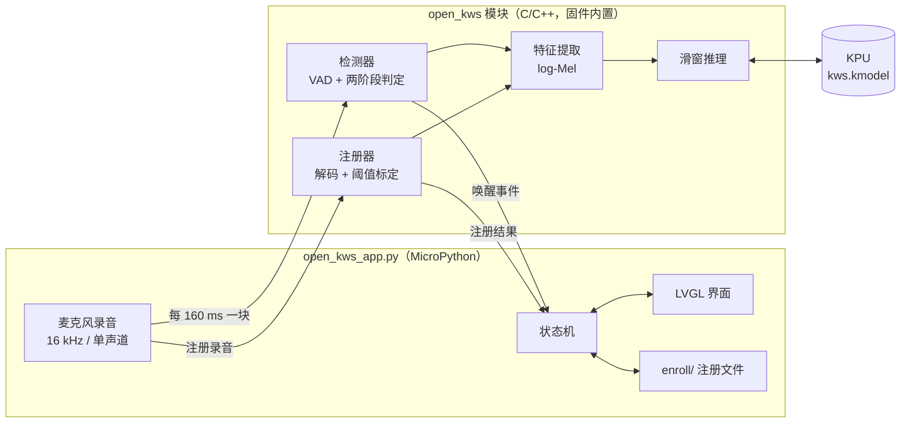
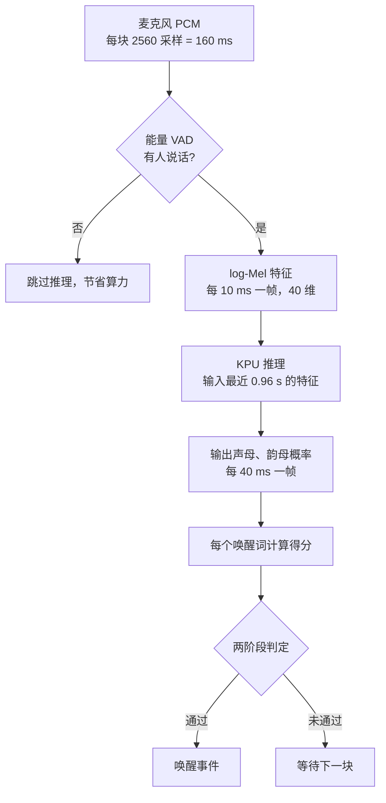
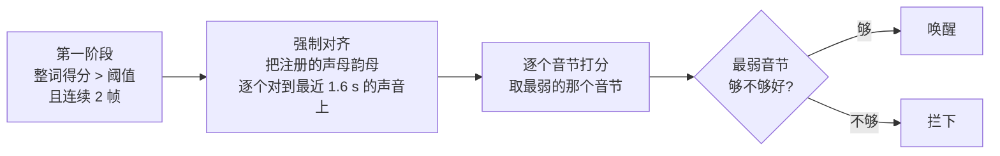
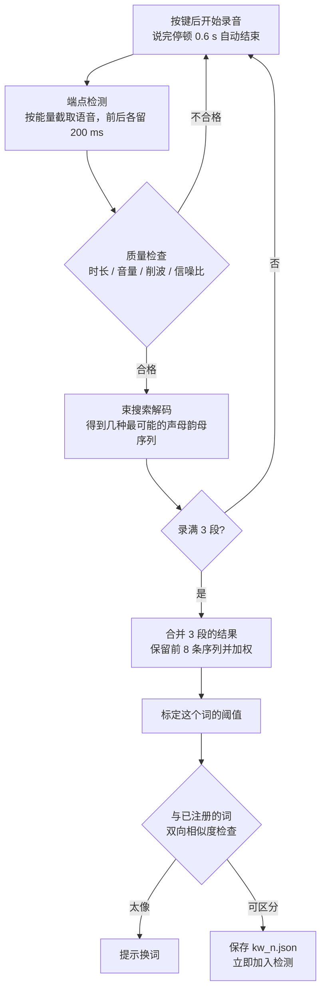
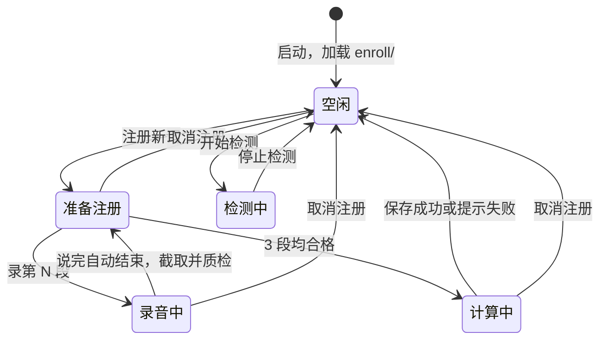

# 31-OPEN-KWS 开放词汇关键词唤醒

想让设备听到「你好小楠」就响应，或者换成任何你喜欢的词？这个示例让你**用自己的声音，现场注册自己的唤醒词**。
注册后，设备持续监听麦克风，听到其中任何一个词就立即唤醒，并告诉你是哪一个。

注册和检测全部在 K230 开发板上离线完成：不需要电脑重新训练模型，也不需要联网。

## 功能特点

| 特性 | 说明 |
|---|---|
| 唤醒词随你定 | 不限词表，录 3 遍就能注册；建议 4 个字以上，如「你好小楠」「小楠同学」 |
| 多个唤醒词 | 最多 8 个，同时监听并区分是哪一个。所有词共用一次神经网络推理，增加词数几乎不增加开销 |
| 分得清相似词 | 两道关卡判定：「小楠同学」和「小智同学」只差一个字，也不会互相误唤醒；注册时还会提前拦下太像的词 |
| 响应快 | 每 160 ms 处理一次音频，说完到唤醒约 0.3 s；神经网络在 KPU 上运行，其余计算在固件 C/C++ 模块中完成 |
| 录音省心 | 说完即自动停止录音；声音太大时自动调低麦克风音量，音量条变红提醒；没说话会超时提醒 |
| 唤醒提示 | 唤醒时扬声器播放提示音，屏幕以该词的颜色高亮显示 |
| 灵敏度可调 | 「灵敏 / 正常 / 保守」三档，同时调整两道关卡的松紧 |
| 灵活管理 | 可以单独删除某个唤醒词，也可以一键清空；注册过程中随时可以取消 |
| 多种屏幕 | 默认使用 IDE 虚拟屏，也支持开发板 LCD 触摸屏和 HDMI；界面按分辨率和横竖屏自动排版 |
| 离线、私密 | 录音与注册结果只保存在开发板 SD 卡的 `enroll/` 目录 |

---

## 快速上手

在 VS Code 的 **CanMV 插件**中运行 `/sdcard/examples/31-OPEN-KWS/open_kws_app.py`，打开虚拟屏幕预览，用鼠标点击界面上的按钮操作。

| 横屏 800×480 · 检测中 | 竖屏 480×800 · 注册中 |
|:---:|:---:|
|  |  |
| 说出唤醒词后曲线越过红线，弹出「唤醒！kw_0」并播放提示音 | 正在录第 2 段；注册中「注册新词」变为「取消注册」 |

| 区域 | 内容 |
|---|---|
| 顶部 | 标题与灵敏度切换（「灵敏 / 正常 / 保守」，当前档位高亮）；下方一行显示操作提示和结果 |
| 得分卡片 | 曲线为所有唤醒词中「得分 − 阈值」的最大值，越过红线并通过第二道关卡即唤醒；下方有实时音量条、语音指示灯和处理耗时 |
| 唤醒词卡片 | 已注册的词：颜色、编号、阈值、解码出的声韵母，每行带「删除」按钮；词多时可上下滑动 |
| 底部按钮 | 注册新词（注册过程中变为「取消注册」）、录音、开始/停止检测、清空全部 |

### 显示方式

默认使用 IDE 虚拟屏（800×480）。要在实体屏上运行，修改 `open_kws_app.py` 开头「屏幕」配置中的 `DISPLAY_MODE`：

| 取值 | 显示 | 操作 |
|---|---|---|
| `"VIRT"`（默认） | IDE 虚拟屏 | 在 CanMV 插件的预览中用鼠标点击 |
| `"LCD"` | 开发板 MIPI 屏（如 01studio 的 ST7701） | 屏幕自带触摸 |
| `"HDMI"` | HDMI 显示器 | 在 IDE 预览中用鼠标点击 |
| `"AUTO"` | 能打开触摸屏就用开发板 LCD，否则用 IDE 虚拟屏 | 同上 |

- 使用 LCD 时，分辨率根据固件支持的屏幕列表（`Display.list_modes()`）和触摸屏报告的尺寸自动选择，也可以用 `DISPLAY_SIZE` 指定，如 `(480, 800)` 竖屏。
- 界面的字体、间距、按钮按屏幕尺寸缩放：横屏时左右分栏，竖屏时上下排列；大于 1280×720 的屏幕，界面居中显示。

### ① 注册唤醒词

1. 点 **注册新词**。
2. 点 **录第1段**，然后清楚地说一遍唤醒词。
   - 说完停顿约 0.6 秒，录音自动结束（最长 4 秒）；5 秒内没有说话会提示重录。
   - 程序自动截取有声音的部分，并检查录音质量。
   - 录音前可以先看音量条：正常为绿色，变红说明声音过大，请离远一点或小声一些。声音过大导致录音不合格时，程序会自动调低麦克风音量并提示重录，调整后的音量会保存下来，之后的注册和检测都使用它。
3. 照提示录第 2、3 段。某一段不合格时，只需重录这一段。
4. 3 段都合格后自动计算，并检查与已注册的词是否太像，状态栏显示进度。完成后右侧列表出现新词，即注册成功。

注册过程中随时可以点 **取消注册** 放弃本次注册，已注册的词不受影响。
重复以上步骤可以继续添加，最多 8 个。注册结果保存在 `enroll/` 目录，下次启动时自动加载。

### ② 唤醒

1. 点 **开始检测**，对着麦克风说任一已注册的词。
2. 唤醒时扬声器播放提示音，屏幕以该词的颜色显示「唤醒！kw_n」，串口打印：
   ```
   >>> WAKE kw_0 score=-0.707 th=-2.987 @12.56s
   ```
3. 再点一次（按钮变为 **停止检测**）即停止。

提示音默认为内置的「叮咚」声，可以通过 `WAKE_SOUND` 换成自己的 wav 文件（16 kHz 单声道），如 `"/sdcard/examples/utils/wozai.wav"`，或设为 `None` 关闭。

### ③ 灵敏度

点右上角的「灵敏 / 正常 / 保守」切换，立即生效，对所有词有效：

| 档位 | 适合场景 |
|---|---|
| 灵敏 | 安静环境、说话较轻，希望更容易唤醒 |
| 正常（默认） | 大多数场景，兼顾唤醒率和抗误唤醒 |
| 保守 | 注册了几个相近的词，或周围人声多，希望尽量不误唤醒 |

### ④ 删除唤醒词

- **删除单个**：点该词所在行的 **删除**，按钮变为 **确认删除**，3 秒内再点一次即删除这个词及其录音。检测过程中也可以删除。
- **一键清空**：点 **清空全部**，按钮变为 **确认清空?**，3 秒内再点一次即删除全部唤醒词和录音；清空后新词从 `kw_0` 重新编号。

两种操作 3 秒内不再点击都会自动取消。

### 注册时可能遇到的提示

| 提示 | 原因 | 处理 |
|---|---|---|
| 录音太短 / 太长 | 截取后的语音不在 0.6–2.5 s 之间 | 完整说一遍唤醒词，不要多说其他话 |
| 音量过低 | 峰值太小 | 靠近麦克风，30–100 cm 较合适 |
| 音量过大（削波） | 波形被截顶的采样过多，且麦克风音量已调到最低 | 离远一点或小声一些 |
| 没有检测到说话声 | 5 秒内音量一直没有明显高于环境底噪 | 靠近麦克风、说话大声一些 |
| 环境太吵 | 语音比环境底噪高不到 10 dB | 换到安静的地方，或靠近麦克风说话 |
| 唤醒词太短 | 音节数少于 4 | 换一个 4 个字以上的词 |
| 几段录音差异太大 | 算出的阈值高于最差的那段录音 | 三遍保持相同的语速和音量 |
| 与已注册的 kw_x 太相似 | 新词会唤醒 kw_x | 换一个读音区别更明显的词 |
| 说 kw_x 时也会唤醒新词 | 新词会被 kw_x 唤醒，例如新词是旧词的一部分（「来了在的」⊂「我来了在的」） | 换一个词 |

---

## 实现原理

### 1. 整体结构

计算全部在固件内置的 `open_kws` 模块（C/C++）中完成，示例脚本只负责界面、录音和文件管理。



**声学模型的作用**：模型不直接识别某个词，而是把声音转换成 59 类「拼音单元」的概率，分别是 21 个声母、35 个韵母，以及空白、静音和未知。
任意一个唤醒词都可以写成一串声母韵母，例如「小楠同学」= `x iao n an t ong x ve`。所以不用重新训练模型，就能支持任意的词。

### 2. 流式检测



| 环节 | 实现要点 |
|---|---|
| 特征提取 | 512 点 FFT、10 ms 帧移、40 维梅尔滤波并做归一化，与模型训练时完全一致 |
| 滑窗推理 | 推理窗 96 帧（0.96 s），每 160 ms 滑动一次并重算；模型输出 24 帧，只取中间几帧，避开窗口边缘的不准确区域 |
| 打分 | CTC 前向算法：计算「最近这段声音按这串声母韵母念出来」的概率。允许从任意时刻开始，并按单元数归一化，长词短词可以用同一套标准 |
| 多唤醒词 | 所有词共用同一次 KPU 推理，每个词只多一次打分计算 |
| 触发 | 连续 2 帧满足条件才触发；同一个词触发后冷却 1.5 s，避免重复唤醒 |
| 延迟 | 约 0.3 s（模型右侧需要等待 80 ms + 一个 160 ms 的处理步长 + 计算时间） |

### 3. 两阶段判定：为什么能分清相似词

第一阶段的得分是整个词的平均水平。「小智同学」和「小楠同学」有 3 个字完全相同，平均下来差距很小，单靠它分不开。所以触发前再加一道逐字核对：



- 真正说的是这个词时，每个音节的得分都接近 0（对数概率）。
- 只差一个字的相似词，那个不同的音节会低到 −5 ~ −10，因此被拦下。
- 判定规则：`最弱音节得分 + α × (整词得分 − 阈值) > −3.0 + δ`。
  - 整词得分超出阈值越多，对最弱音节的要求越宽松，减少真词被误拦。
  - 注册时会解码出多条可能的声母韵母序列，逐字核对时用其中表现最好的一条，避免某一条在个别音节上解码不准导致漏唤醒。

灵敏度档位同时调整两道关卡：

| 档位 | 第一关阈值偏移 | 逐字核对用的序列条数 | α | δ |
|---|---|---|---|---|
| 灵敏 | −0.15 | 8 | 0 | 0 |
| 正常 | 0 | 8 | 2.0 | +1.25 |
| 保守 | +0.15 | 3 | 2.0 | +1.25 |

### 4. 注册：从 3 段录音学会一个词



- **录音与质量检查**：
  - 空闲时持续估计环境底噪；录音中音量明显高于底噪即判定开始说话，说话后约 0.6 s 回到底噪附近即结束。
  - 信噪比 = 语音能量 ÷ 环境底噪，两者都先去除麦克风的直流偏置。
  - 削波过多时自动降低麦克风音量并保存，注册和检测始终使用同一音量。
- **阈值标定**：每个词的阈值单独计算，不用一个固定值。
  - **正例**：用其中 2 段录音得到的序列，去给剩下那段打分，轮流 3 次（留一法），代表「真的说了这个词」的得分。
  - **负例**：把每段录音切成 3 份，打乱顺序重新拼接，共 5 种排列。音色、音素都一样但顺序不对，代表「听起来像但不是」的得分。
  - **阈值**：取在两者之间、更靠近负例的位置，即 `0.38 × 正例均值 + 0.62 × 负例均值`。
- **双向相似度检查**：使用当前灵敏度档位的两阶段规则，并留有余量。
  - **正向**：已注册的词在新录音上会不会被唤醒？
  - **反向**：新词在已注册词的保存录音上会不会被唤醒？
- **更多检查**：音节数不少于 4，以及最差的一段录音也能超过阈值。

### 5. 应用流程



- **单线程主循环**：每轮取一块音频，按当前状态处理，然后刷新 LVGL 界面并读取触摸；按钮回调只记录动作，实际工作放在主循环里执行。
- **注册计算分步执行**：阈值标定和相似度检查逐步完成，每步之间刷新界面并显示进度，计算期间界面保持响应。
- **出错不退出**：模型或文件出错时提示原因，取消当前注册或停止检测，应用继续可用。

---

## 开发接口

`open_kws` 是固件内置模块，直接 `import open_kws` 即可使用。模块由 menuconfig 中的 `CanMV Micropython Components Configurations → Enable open-vocabulary KWS (open_kws) module`（`CONFIG_ENABLE_MODULE_OPEN_KWS`）控制，默认开启；关闭后固件不包含该模块，SD 卡镜像也不再带本示例。

最小用法：

```python
import open_kws, json

ROOT = "/sdcard/examples/31-OPEN-KWS/"
eng = open_kws.Engine(ROOT + "model/kws.kmodel", ROOT + "assets")

with open(ROOT + "enroll/kw_0.json") as f:      # 加载已注册的唤醒词
    eng.add_keyword(json.load(f))
eng.set_sensitivity("normal")                   # 第一关：阈值偏移
eng.set_verify(n_hyps=8, alpha=2.0, delta=1.25) # 第二关：与示例「正常」档一致

# 麦克风：16 kHz、单声道、16 bit，每块 2560 个采样（open_kws.CHUNK）
events = eng.push(pcm)
for kw_id, score, threshold, start_ms, end_ms in events:
    print("唤醒:", kw_id)                       # 在这里接你自己的动作
```

常用接口：

| 接口 | 作用 |
|---|---|
| `Engine(kmodel, assets)` | 加载模型与特征参数 |
| `add_keyword(rec)` / `set_keywords([...])` / `clear_keywords()` / `keywords()` | 管理唤醒词，`rec` 为注册结果 dict |
| `push(pcm)` | 送入一块音频，返回本块的唤醒事件 `(kw_id, score, threshold, start_ms, end_ms)` |
| `set_sensitivity(level)` | 第一关阈值偏移：`"sensitive"` / `"normal"` / `"conservative"` 或浮点数 |
| `set_verify(n_hyps, alpha, delta)` | 第二关规则（见上文判定规则） |
| `stats()` | 处理耗时、音量、VAD 状态，以及每个词的当前得分 |
| `trim(pcm)` / `check_audio(pcm)` / `level(pcm)` | 注册用：截取语音段、质量检查、计算一块音频的音量与峰值 |
| `set_quality(clip_ratio, min_snr)` | 注册录音的质量要求：削波采样比例上限、最低信噪比 |
| `enroll_begin()` → `enroll_add(seg, noise)` ×3 → `enroll_step()` 循环 → `enroll_result(kw_id)` → `enroll_end()` | 注册流程；`noise` 为录音前的环境底噪，作为信噪比的参考 |
| `enroll_confusion()` / `probe(rec, pcm)` | 注册时的相似度检查 |

完整的注册与界面流程可以参考 `open_kws_app.py`。

### 注册结果文件

每个唤醒词保存为一个 `enroll/kw_<n>.json`，主要字段：

```json
{
  "kw_id": "kw_0",
  "hypotheses": [
    {"units": [21, 38, 14, 26, 20, 45, 21, 57], "weight": 0.195},
    {"units": [21, 38, 13, 26, 20, 45, 21, 57], "weight": 0.123}
  ],
  "threshold": -3.1259,
  "verify_threshold": -3.0,
  "cooldown_ms": 1500,
  "confirm_frames": 2
}
```

| 字段 | 说明 |
|---|---|
| `hypotheses` | 注册解码出的声母韵母序列（数字对应 `units.txt` 的行号）及权重 |
| `threshold` | 第一关阈值，每个词单独标定 |
| `verify_threshold` | 第二关基准阈值 |
| `cooldown_ms` / `confirm_frames` | 触发冷却时间、连续确认帧数 |

---

## 文件说明

| 文件 | 说明 |
|---|---|
| `open_kws_app.py` | 示例程序：LVGL 界面、状态机、录音与提示音、注册文件管理 |
| `model/kws.kmodel` | 声学模型：输入 40×96 特征，输出 24 帧 × 59 类拼音单元概率 |
| `assets/` | 特征提取参数（窗函数、梅尔滤波器、归一化参数），须与模型匹配，请勿修改 |
| `units.txt` | 59 个拼音单元列表 |
| `enroll/` | 运行时生成：`kw_<n>.json` 和录音 `kw_<n>_clip_<k>.wav`（反向相似度检查会用到），以及保存麦克风音量的 `settings.json` |

## 可调参数

所有可调参数都集中在 `open_kws_app.py` 开头的「可配置参数」区，按用途分组，修改一处即可生效。

**屏幕**

| 参数 | 默认值 | 说明 |
|---|---|---|
| `DISPLAY_MODE` | `"VIRT"` | 显示方式：`"VIRT"` / `"LCD"` / `"HDMI"` / `"AUTO"` |
| `DISPLAY_SIZE` | None | 指定分辨率，如 `(480, 800)`；None 为自动选择或默认分辨率 |
| `TOUCH_ROTATE` | None | LCD 触摸旋转（屏幕与触摸方向不一致时设置） |
| `VIRT_SIZE` | (800, 480) | IDE 虚拟屏的分辨率 |
| `UI_MAX` | (1280, 720) | 界面最大分辨率，更大的屏幕居中显示 |

**音频**

| 参数 | 默认值 | 说明 |
|---|---|---|
| `MIC_VOLUME` | 100 | 初始麦克风音量 |
| `AUTO_MIC_GAIN` | True | 录音削波时自动调低麦克风音量并保存 |
| `MIC_VOLUME_STEP` / `MIC_VOLUME_MIN` | 10 / 40 | 自动调低的步长和下限 |
| `WAKE_SOUND` | `"chime"` | 唤醒提示音：`"chime"` 内置提示音 / 16 kHz 单声道 wav 路径 / None 关闭 |
| `SPEAKER_VOLUME` | 85 | 提示音音量 |

**检测与灵敏度**

| 参数 | 默认值 | 说明 |
|---|---|---|
| `SENS_TIERS` | 灵敏 / 正常 / 保守 | 每档为 (名称, 第一关阈值偏移, n_hyps, α, δ)，右上角的档位按钮按此生成 |
| `SENS_DEFAULT` | 1（正常） | 启动时的档位 |
| `WAKE_SHOW_MS` | 1500 | 唤醒提示显示时长（ms） |

**注册与录音**

| 参数 | 默认值 | 说明 |
|---|---|---|
| `N_CLIPS` | 3 | 每个词的注册录音段数 |
| `REC_END_SILENCE` / `REC_MAX_CHUNKS` / `REC_WAIT_CHUNKS` | 4 / 25 / 31 | 录音自动结束：说完后的静音时长（0.64 s）、最长录音（4 s）、等待说话的超时（5 s），单位为 160 ms 一块 |
| `SPEECH_RATIO` / `SPEECH_ABS` | 2.5 / 0.03 | 判定为说话的音量：高于底噪的倍数，或超过绝对音量 |
| `CLIP_RATIO_MAX` / `MIN_SNR_DB` | 0.005 / 10 | 录音质量要求：允许的削波采样比例、最低信噪比 |
| `SAVE_CLIPS` | True | 保存注册录音；关闭后不做反向相似度检查 |
| `CONFUSION_MARGIN` / `VERIFY_CONFUSION_MARGIN` | −0.15 / −0.5 | 注册相似度检查的余量，越小越严格 |

界面配色、字体、得分曲线范围、各种二次确认时间等也在同一配置区，可按需调整。

## 使用建议

- **注册环境与使用环境尽量一致**：同一个麦克风、差不多的距离和音量。
- **选词**：4 个字以上，不是日常口头禅，各个词之间读音区别明显。
- **易混音**：只靠模型本身容易混淆的音来区分的词（如 lan/nan、in/ing、ai/an），两道关卡也难以分辨，建议避开。
- **调灵敏度**：漏唤醒多就切「灵敏」，误唤醒多就切「保守」。
- **备份**：重新烧录固件会清空 `enroll/`，需要保留的唤醒词请先备份。
