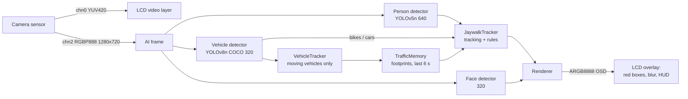
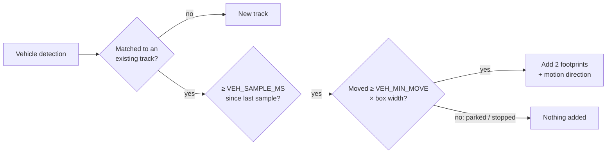
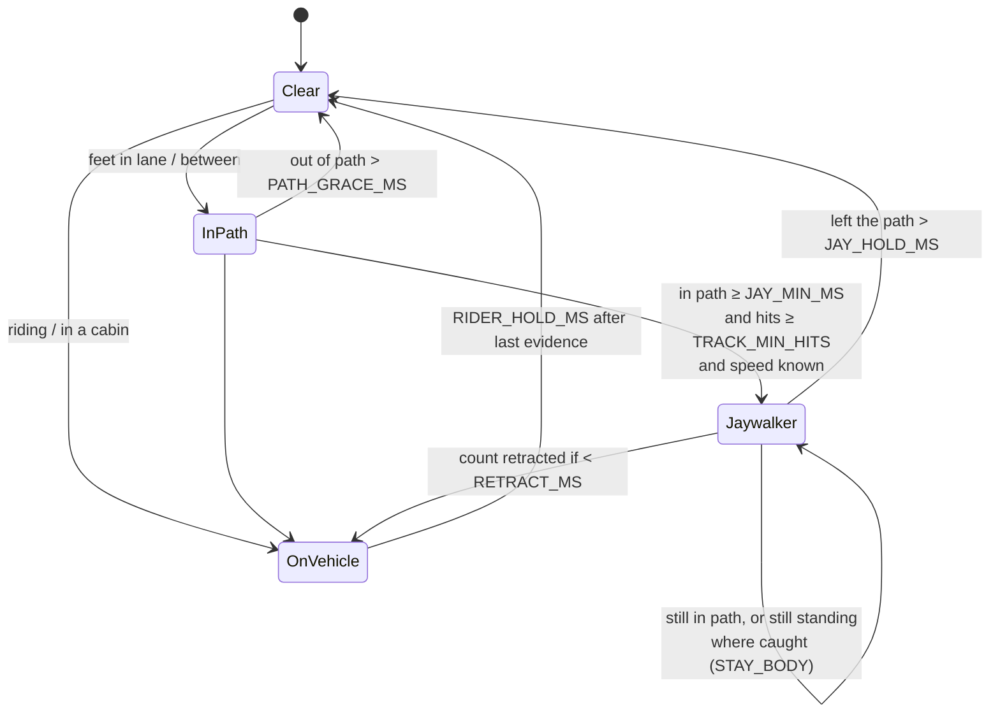

# Jaywalking Detector — Architecture

`jaywalk_detect.py` · CanMV K230 (MicroPython) · on-board camera in, LCD out

---

## 1. Summary

The script watches a street through the K230's on-board camera and shows on the LCD:

- a **red box** around anyone who is **jaywalking**, meaning they are standing or walking in the path of moving traffic;
- a **count** of jaywalkers, where each person is counted once;
- a **mosaic blur** over the face of **every** person on screen, whether jaywalking or not.

The script has no road map, no calibration and no zones to draw. It treats the road as **wherever vehicles have just driven**. Someone whose feet are in that path, or between lanes with traffic on both sides, is jaywalking. Two groups are never flagged:

- people on the pavement, because traffic passes on one side of them only;
- people riding a motorbike or bicycle, or sitting in a car.

Everything runs on the board. No image is stored or sent anywhere.

---

## 2. System overview

The camera feeds two channels:

| Channel | Format | Size | Used for |
|---|---|---|---|
| chn0 | YUV420 | display size | Live video shown on the LCD |
| chn2 | RGB planar (RGBP888) | 1280 × 720 | Input to all three AI models, and source pixels for the blur |

All drawing (boxes, mosaic, HUD) goes on a transparent **OSD layer** on top of the video. The video itself is never modified.

### Per-frame loop

1. Grab the AI frame.
2. Run the **person** detector (every frame).
3. Run the **vehicle** detector (every `VEH_EVERY` frames; default every frame).
4. Run the **face** detector (every `FACE_EVERY` frames; default every 2nd).
5. Drop traffic footprints older than `TRAFFIC_WINDOW_MS`.
6. Update vehicle tracks. Each **moving** vehicle adds footprints.
7. Update person tracks and apply the jaywalking rules.
8. Draw: blur every head and face, then draw red boxes and the HUD.
9. Show the frame; run garbage collection.

---

## 3. Models deployed

All three are stock models from the CanMV examples under `/sdcard/examples/kmodel/`. They run on the K230's KPU (NPU). Before inference, each frame is resized and padded by the **AI2D** hardware block.

| | Person detector | Vehicle detector | Face detector |
|---|---|---|---|
| **File** | `person_detect_yolov5n.kmodel` | `yolov8n_320.kmodel` | `face_detection_320.kmodel` (+ `prior_data_320.bin` anchors) |
| **Architecture** | YOLOv5-nano, single class "person" | YOLOv8-nano, 80 COCO classes | Anchor-based face detector (4200 prior boxes) |
| **Input** | 640 × 640, centre-padded | 320 × 320, letterboxed | 320 × 320, letterboxed |
| **Post-processing** | `aicube.anchorbasedet_post_process` (anchors, strides 8/16/32, NMS) | `aidemo.yolov8_det_postprocess` (NMS) | `aidemo.face_det_post_process` (NMS) |
| **Classes used** | person | car (2), motorcycle (3), bus (5), truck (7), bicycle (1) | face |
| **Role** | Who is in the scene; their feet position | Where traffic drives; who is riding | Extra face coverage for the blur |
| **Runs** | Every frame | Every `VEH_EVERY` frames | Every `FACE_EVERY` frames |

Why two detectors instead of one:

- **People:** the dedicated person model runs at 640 px, so it finds small, distant pedestrians that a 320 px COCO model misses.
- **Vehicles:** the COCO model provides the vehicle and bike classes that the rules depend on.

---

## 4. Jaywalking detection mechanism

### 4.1 Traffic footprints — "the road is where vehicles just drove"

- **VehicleTracker** matches each vehicle detection to the previous frame's tracks: the nearest centre within `VEH_MAX_MOVE` box sizes, of similar size (`VEH_SIZE_RATIO`).
- About 5 times a second, each tracked vehicle is checked for movement. **Only vehicles that move leave footprints**, so a car parked on the pavement does not turn the pavement into a lane.
- A **footprint** is the bottom `VEH_FOOT` (25 %) of the vehicle box, where its wheels meet the ground, together with the direction the vehicle was moving.
- **TrafficMemory** keeps footprints for `TRAFFIC_WINDOW_MS` (6 s) and at most `TRAFFIC_MAX` of them. Nothing is kept longer than that, so the "road" always reflects current traffic.

### 4.2 The jaywalking rule

For each tracked person, the **feet** (bottom-centre of their box, smoothed) are compared with the recent footprints. Body height is used as the unit of distance, so the rule works the same for near and far people.

| Result | Condition | Meaning |
|---|---|---|
| **`lane`** | Feet inside any footprint (grown by `LANE_MARGIN` × body height) | Standing in a lane vehicles were just using |
| **`between`** | At least `MIN_SIDE_HITS` footprints on **each** side of the person, within `ACROSS_BODY` body heights across the road and `ALONG_BODY` along it | Between lanes, with traffic on both sides |
| **`clear`** | Neither | Pavement, verge, or nowhere near traffic |

For **`between`**, "across" means perpendicular to the **dominant direction of nearby traffic**. Directions are averaged without regard to sign, so opposite lanes agree, and one stray direction from a mis-tracked vehicle can't tilt the axis. Someone on the pavement only ever has traffic on one side, so they never qualify.

A person is flagged as a **jaywalker** when all of the following hold:

- they are `lane` or `between` continuously for at least `JAY_MIN_MS`,
- their track has at least `TRACK_MIN_HITS` detections,
- their walking speed is already known, which takes `SPEED_WINDOW_MS` (see 4.3).

Brief drop-outs shorter than `PATH_GRACE_MS` don't reset the timer.

The red box stays on while the person remains within `STAY_BODY` body heights of where they were caught. This applies even after the surrounding traffic has aged out of the 6 s window. Once they move away, the box stays on for `JAY_HOLD_MS` and then disappears.

### 4.3 People on vehicles are never jaywalkers

The person detector also finds motorbike riders, cyclists and passengers. Such a person is excluded (`on vehicle`) if any of these applies:

| Check | How |
|---|---|
| **Sitting on a bike** | Person box centred over a bicycle or motorbike box, reaching down into it, with the head above it |
| **Inside a cabin** | ≥ `CABIN_INSIDE` of the person box lies inside a car, bus or truck box, **and** their feet are well above its wheels. Someone standing *in front of* a bus has feet on the road and is not excluded |
| **Repeated** | The checks above must hold in `RIDER_MIN_FRAMES` frames within `RIDER_WINDOW_MS`, so a bike merely passing in front of a pedestrian doesn't excuse them |
| **Moving at vehicle speed** | Feet move faster than `RIDER_SPEED_BODY` body heights per second. This catches riders whose bike is never detected |
| **Held** | Once on a vehicle, the person stays excluded for `RIDER_HOLD_MS`, because the detector often drops the bike for a frame while still seeing the rider |
| **Own vehicle's trail** | Footprints younger than `LANE_FRESH_MS` directly under a person are ignored, because they belong to the vehicle that person is riding |
| **Retraction** | If someone was counted and turns out to be on a vehicle within `RETRACT_MS`, the count is taken back |

Speed is only measured over continuous tracking. After a tracking gap longer than `SPEED_GAP_MS`, the speed history restarts.

### 4.4 Counting each person once

| Cause of double counting | Fix |
|---|---|
| Two boxes on one person (full body + upper body) | Boxes sharing ≥ `DUP_CONTAIN` of the smaller one are merged before tracking |
| Person hidden behind a passing car, or missed by the detector | Lost tracks are kept as **ghosts** for `GHOST_MS`. A person reappearing within `GHOST_GATE` + `GHOST_SPEED` × seconds-lost body heights, with a similar box size (`GHOST_SIZE_RATIO`), takes the old track over, **including its counted state** |

### 4.5 Legal crossings

Zebra crossings look like any other road to this method. If the camera sees one, list its corners in `CROSSWALK_ZONES` as normalised (0–1) polygons. People with their feet inside a zone are never flagged.

---

## 5. Privacy — face blur

Every person on screen gets their head pixelated with a `BLOCKS` × `BLOCKS` mosaic made from their own pixels. Two sources are combined:

1. **The head area estimated from each person box**, drawn every frame. It works for people facing away or too small for a face detector. It's kept for `MASK_HOLD_MS` after a person is last seen, so a one-frame detector miss doesn't uncover a face.
2. **Faces found by the face detector**, padded by `FACE_PAD`. These catch faces the person detector missed.

The blur is drawn **before** the red boxes, so the outline stays visible on top.

---

## 6. Display

| Element | Content |
|---|---|
| Red box + "JAYWALKING" | Each current jaywalker |
| HUD line 1 | `Jaywalkers: N`, the running total |
| HUD line 2 | `Jaywalking now: N` |
| HUD line 3 | `Traffic seen (n)` or `No moving traffic`. With no recent traffic, nobody can be flagged |
| Debug only | Cyan footprint rectangles; a grey box on every person labelled `lane` / `between` / `clear` / `on vehicle` / `crosswalk` and how long they've been in the path |

Console messages: `jaywalker #N (track id, lane|between)`, `retracted track id: on a vehicle`, and on exit `jaywalkers counted this run: N`.

---

## 7. Adjustable parameters

All parameters are constants at the top of `jaywalk_detect.py`. Distances are in **body heights** of the person concerned (unless marked px), so they scale with distance from the camera.

### 7.1 How easily someone is flagged

| Parameter | Default | Effect | Flag **more** people | Risk if pushed too far |
|---|---|---|---|---|
| `JAY_MIN_MS` | 500 ms | How long someone must be in the traffic path | ↓ lower | Brief steps off the kerb get counted |
| `LANE_MARGIN` | 0.1 | How far around a footprint still counts as "in the lane" | ↑ raise | People at the kerb edge get flagged |
| `ACROSS_BODY` | 4.0 | How far to each side traffic may be for "between" | ↑ raise | Pavement walkers next to wide roads get flagged |
| `ALONG_BODY` | 2.0 | How far along the road that traffic may be | ↑ raise | Traffic far up the road counts |
| `SIDE_MIN_BODY` | 0.15 | Minimum offset for a footprint to count as "on a side" | ↓ lower | Jitter puts one footprint on both sides |
| `MIN_SIDE_HITS` | 2 | Footprints needed on **each** side | ↓ lower (1) | One stray footprint can trigger "between" |
| `TRAFFIC_WINDOW_MS` | 6000 ms | How long "just drove through" lasts | ↑ raise | Lanes linger after traffic changes; parked-then-moved cars leave old trails |
| `PATH_GRACE_MS` | 700 ms | Out-of-path blips tolerated | ↑ raise | Someone who stepped back onto the pavement stays "in path" longer |
| `TRACK_MIN_HITS` | 3 | Detections before a person can be flagged | ↓ lower | One-frame false detections can be counted |

### 7.2 Vehicles and road evidence

| Parameter | Default | Effect | Notes |
|---|---|---|---|
| `VEH_CONF` | 0.3 | Vehicle detection confidence | Lower finds more vehicles, so more lanes; also more false vehicles |
| `VEH_NMS` | 0.45 | Overlap allowed between vehicle boxes | |
| `VEH_EVERY` | 1 | Run vehicle detector every N frames | 2–3 is faster but may miss fast motorbikes |
| `VEH_MIN_MOVE` | 0.05 | Minimum move (× box width) to count as moving | Raise if parked cars "jitter" into lanes |
| `VEH_SAMPLE_MS` | 200 ms | How often vehicle motion is sampled | |
| `VEH_MAX_MOVE` | 1.5 | Max jump between frames (× box size) for tracking | Raise for very fast traffic at low frame rates |
| `VEH_SIZE_RATIO` | 1.6 | Max size change for a vehicle match | |
| `VEH_FOOT` | 0.25 | Bottom fraction of a vehicle box used as its footprint | Raise for high camera angles where vehicles cover more ground |
| `TRAFFIC_MAX` | 300 | Cap on stored footprints | Limits per-frame work |

### 7.3 People on vehicles

| Parameter | Default | Effect | Notes |
|---|---|---|---|
| `RIDER_SPEED_BODY` | 3.0 /s | Faster than this counts as riding | Lower catches slow riders, but a running pedestrian may be excused |
| `RIDER_MIN_FRAMES` / `RIDER_WINDOW_MS` | 2 / 1000 ms | Sightings on a bike needed, and in what time | Raise frames to stop passing bikes excusing pedestrians |
| `RIDER_HOLD_MS` | 3000 ms | How long "on a vehicle" persists | Raise if riders still get counted when the bike flickers |
| `CABIN_INSIDE` | 0.6 | Share of person box inside a car/bus to count as a passenger | |
| `LANE_FRESH_MS` | 800 ms | Ignore this-young footprints under a person | |
| `RETRACT_MS` | 2000 ms | Window to undo a count for a late-recognised rider | |
| `SPEED_WINDOW_MS` / `SPEED_GAP_MS` | 500 / 400 ms | Speed measurement span / gap that restarts it | |

### 7.4 Tracking and counting once

| Parameter | Default | Effect | Notes |
|---|---|---|---|
| `GHOST_MS` | 8000 ms | How long a lost person is remembered | Raise if people hidden for longer are counted twice |
| `GHOST_GATE` / `GHOST_SPEED` | 1.0 / 1.5 | Revival distance: base + per second lost (body heights) | Too large: a *different* person nearby inherits the count and is missed |
| `GHOST_SIZE_RATIO` | 1.8 | Max size change for revival | |
| `DUP_CONTAIN` | 0.7 | Overlap that marks two boxes as one person | Lower merges more; too low merges people standing close together |
| `TRACK_TIMEOUT_MS` | 2000 ms | Unseen time before a track is dropped (becomes a ghost) | |
| `TRACK_MAX_MOVE` | 1.0 | Max jump between frames (× box size) | |
| `FOOT_SMOOTH` | 0.5 | Smoothing of the feet position (1 = none) | |
| `MIN_PERSON_H` | 30 px | Ignore smaller person boxes | Lower for distant pedestrians |
| `PERSON_CONF` / `PERSON_NMS` | 0.3 / 0.5 | Person detection confidence / overlap | Lower confidence finds more people, and more false ones |

### 7.5 Display, privacy and performance

| Parameter | Default | Effect |
|---|---|---|
| `JAY_HOLD_MS` | 2000 ms | Red box lingers after the person leaves the path |
| `STAY_BODY` | 0.5 | Box stays on while they remain this close to where caught |
| `USE_FACE_DET` | True | Turn the face detector off for speed. Heads are still blurred from person boxes |
| `FACE_EVERY` | 2 | Run face detector every N frames |
| `FACE_CONF` / `FACE_PAD` | 0.4 / 0.2 | Face detection confidence / blur padding |
| `BLOCKS` | 5 | Mosaic coarseness. Fewer blocks give a stronger blur |
| `MASK_HOLD_MS` | 500 ms | Keep blurring a head after the person is last seen |
| `CROSSWALK_ZONES` | `[]` | Legal crossing polygons (normalised 0–1) |
| `SHOW_ALL_PEOPLE` | False | Grey box around everyone |
| `DEBUG` / `DEBUG_TIMING` | False | On-screen diagnostics / per-frame timings |
| `DISPLAY_MODE` / `DISPLAY_SIZE` | `"lcd"` / panel default | Output device |

### 7.6 Quick tuning guide

| Symptom | Adjust |
|---|---|
| Obvious jaywalkers not flagged | Turn on `DEBUG`. If they show `clear` with no cyan footprints nearby, lower `VEH_CONF`. If footprints are nearby, raise `ACROSS_BODY` or `LANE_MARGIN`, or lower `MIN_SIDE_HITS` |
| Flagged too late | Lower `JAY_MIN_MS` |
| Pavement walkers flagged | Lower `ACROSS_BODY` and `LANE_MARGIN`, raise `MIN_SIDE_HITS` |
| Riders counted | Raise `RIDER_HOLD_MS`, lower `RIDER_SPEED_BODY` |
| Same person counted twice | Raise `GHOST_MS` and `GHOST_SPEED`, lower `DUP_CONTAIN` |
| Two people counted as one | Lower `GHOST_GATE` / `GHOST_SPEED` |
| Legal crossers flagged | Add the zebra crossing to `CROSSWALK_ZONES` |
| Too slow | `USE_FACE_DET = False`, raise `FACE_EVERY`, set `VEH_EVERY = 2` |

---

## 8. Known limitations

- **No moving traffic, no detection.** On an empty road, or when all traffic is stopped, nobody can be flagged.
- **One-sided traffic.** If only one vehicle passes, on one side of a person standing in the road, that looks the same as someone on the pavement.
- **Zebra crossings** must be entered by hand in `CROSSWALK_ZONES`.
- **Sprinters** faster than `RIDER_SPEED_BODY` are treated as riding.
- **Ghost revival** can pass a counted person's identity to a different person who appears at the same spot within seconds.
- **Validation status:** the rules were checked in a box-level simulation of 20 scenarios: in-lane, between lanes, crossing, pavement walkers, riders with flickering or missing bike detections, passengers, duplicate boxes, occlusion, and two separate jaywalkers. They have not yet been validated on live footage from the K230.

---

## 9. Requirements

- CanMV K230 board, firmware v1.8 or later, with the on-board camera and an LCD.
- On the SD card, from the standard CanMV examples:
  - `/sdcard/examples/kmodel/person_detect_yolov5n.kmodel`
  - `/sdcard/examples/kmodel/yolov8n_320.kmodel`
  - `/sdcard/examples/kmodel/face_detection_320.kmodel`
  - `/sdcard/examples/utils/prior_data_320.bin`
- To run: open `jaywalk_detect.py` in CanMV IDE and run it, or save it to the board as `/sdcard/main.py` to start on power-up.
